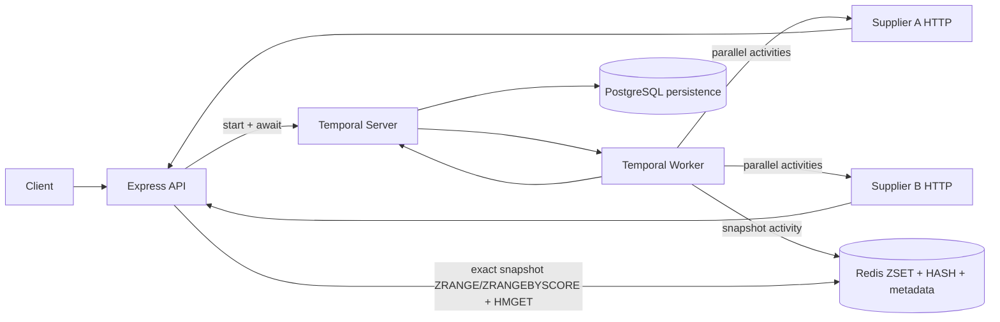

# Hotel Offer Orchestrator

A TypeScript/Express service that obtains live offers from two deterministic supplier HTTP endpoints using a Temporal workflow, chooses the cheapest normalized hotel offer, stores a versioned snapshot in Redis, and uses Redis sorted-set range queries for price filtering.

## Architecture



### Workflow execution

```mermaid
sequenceDiagram
  participant C as Client
  participant API as Express API
  participant R as Redis
  participant T as Temporal
  participant W as Worker
  API->>R: INCR city generation
  API->>T: start unique city/generation workflow
  T->>W: execute HotelAggregationWorkflow
  par Independent supplier activities
    W->>API: GET supplierA/hotels?city=...
    W->>API: GET supplierB/hotels?city=...
  end
  W->>W: Promise.allSettled and aggregate
  W->>R: save versioned ZSET, HASH, metadata; publish pointers
  API->>R: query exact workflow snapshot by price score
  API-->>C: JSON array + completeness headers
```

## Responsibilities and decisions

- **Express API** validates queries, allocates generations, starts a workflow for every valid hotel request, then reads the exact resulting snapshot from Redis.
- **Temporal** runs actual retryable activities and the deterministic aggregation workflow. Supplier calls are concurrent; one failed supplier yields a partial snapshot. Two failures fail the workflow and map to HTTP 503.
- **Redis** stores each immutable generation under `hotels:{city}:snapshot:{snapshotId}`. The price ZSET member and response HASH field share a normalized name key. A transaction writes data and metadata and applies one TTL; a Lua script publishes monotonic latest and latest-complete pointers.
- **PostgreSQL** persists Temporal workflow state. Docker Compose runs the API and worker as independent containers.
- A name key uses NFKC Unicode normalization, lowercase, trimming and whitespace collapse. Equal price ties prefer Supplier A; same-supplier ties use hotel ID ordering. Production systems should use canonical hotel identifiers because distinct hotels can share names.

## Run with Docker

Requires Docker Engine/Desktop with Compose v2.

```sh
cp .env.example .env   # optional; defaults work with Compose
# Set MOCK_SUPPLIER_A_MODE=error in .env to simulate partial mode (restart api)
docker compose up --build
```

API: `http://localhost:3000`; Temporal UI: `http://localhost:8080`. Stop with `docker compose down`; persistent Redis and PostgreSQL volumes remain. Remove persisted state with `docker compose down -v`.

The supplied development failure controls are honored only when `NODE_ENV` is not `production`: `normal`, `error`, `timeout`, `malformed`, `empty`. Configure them through `.env`, then restart with `docker compose up -d --force-recreate api worker`. A simulated timeout lasts beyond the supplier HTTP timeout. Both suppliers failing produces 503 after Temporal retries.

## Local development

Requires Node.js 22, Redis and Temporal Server reachable at the configured addresses.

```sh
npm ci
cp .env.example .env
npm run dev:api
# in a second terminal
npm run dev:worker
```

## Deploy to Vercel with Temporal Cloud

`vercel.json` configures the Express API as a Vercel service and the Temporal worker as a Vercel Daemon. Daemons are in public beta and support long-polling Temporal workers; this keeps the worker separate from the API. The daemon uses the same Dockerfile and overrides its command to run `npm run start:worker`. Its service binding supplies the API URL for supplier calls. Vercel's Express runtime serves `/health/live` and `/health`.

Connect the GitHub repository to Vercel and configure production environment variables: `REDIS_URL` (a TLS-enabled Redis URL from a Vercel Marketplace Redis provider such as Upstash), `TEMPORAL_ADDRESS`, `TEMPORAL_NAMESPACE`, and `TEMPORAL_API_KEY`. Use the Temporal Cloud namespace endpoint and full namespace ID. Enter credentials in Vercel's environment settings only; never commit them. The API derives supplier probe URLs from Vercel's deployment URL, and the daemon receives a service binding for its supplier calls.

Vercel does not run `docker-compose.yml`; that file remains for local development. Redis and Temporal Cloud are managed dependencies outside the Vercel project. Verify the deployment using `/health/live`, `/health`, both supplier endpoints, and `/api/hotels?city=delhi` after configuring those services.

Vercel Daemons have usage-based pricing. The published pricing lists 5 included Daemon active CPU hours and 420 GB-hours of provisioned memory, then starting rates of $0.128 per active CPU hour and $0.0212 per GB-hour of provisioned memory. The API also incurs function usage, while Redis and Temporal Cloud are billed by their providers. The monthly total depends on runtime and usage, so review spend controls before deploying. This repository contains deployment configuration; it does not provision services.

## API

- `GET /api/hotels?city=delhi` — a workflow is executed per request and returns an array of `{name, price, supplier, commissionPct}` records.
- `GET /api/hotels?city=delhi&minPrice=5000&maxPrice=7000` — inclusive Redis ZSET score range; either bound can be omitted. Responses sort by ascending price.
- `GET /supplierA/hotels?city=delhi`, `GET /supplierB/hotels?city=delhi` — deterministic fixtures; unknown cities return `[]`.
- `GET /health` — performs supplier HTTP probes, Redis PING and Temporal connectivity probe. Redis/Temporal down or both suppliers down returns 503; one supplier down is degraded/200.

Successful hotel responses stay plain JSON arrays. Headers include `X-Data-Completeness`, supplier health statuses, `X-Workflow-Id`, and `X-Request-Id`. Errors have `{error:{code,message,requestId}}`. Invalid queries are 400; both suppliers down and critical infrastructure failures are 503; workflow wait deadline is 504 (Temporal execution is not cancelled).

Example:

```sh
curl 'http://localhost:3000/api/hotels?city=delhi&minPrice=5000&maxPrice=7000'
```

Expected qualifying fixture offers are Holtin (₹5,340, Supplier B, 20%) and Radison (₹5,900, Supplier A, 13%).

## Configuration

All settings are environment variables; see `.env.example`. Notable values: `TEMPORAL_ADDRESS`, `TEMPORAL_NAMESPACE`, `TEMPORAL_TASK_QUEUE`, `REDIS_HOST`, `REDIS_PORT`, `SNAPSHOT_TTL_SECONDS` (default 1800), supplier URLs and HTTP timeout, and development mock modes. Compose service URLs use Docker DNS names. Do not use development passwords in deployed environments.

## Tests

```sh
npm ci
npm run build
npm run test:unit
npm test
REDIS_TEST=1 npm run test:integration  # requires Redis on localhost:6379
npm run test:e2e                       # requires the full Docker Compose stack
```

The unit suite validates aggregation, supplier payload validation, HTTP error classifications, and supplier health probes. API tests exercise validation, partial and total supplier failure mapping, and per-request snapshot selection using injected dependency boundaries. The Redis integration test performs real ZSET/HASH and pointer checks when enabled. The Compose E2E suite exercises the real API, Temporal worker/server, supplier endpoints, and Redis.

## Postman

Import `postman/Hotel-Offer-Orchestrator.postman_collection.json`; its `baseUrl` defaults to `http://localhost:3000`. Requests include normal/filter cases, supplier mocks, health, and invalid queries with assertions.

## Troubleshooting and limitations

- If hotel requests wait or return 504, check that the Temporal server and worker are healthy; the workflow continues after the API's wait deadline.
- Check Redis connectivity and the `redis-data` volume if snapshot writes fail.
- The mock API deliberately validates returned city names and uses static Delhi fixture data; other cities return successful empty supplier arrays.
- Supplier and Temporal versions are pinned in Docker Compose; the Temporal auto-setup image expects its PostgreSQL backend.
- This assignment uses names as deduplication identity and in Redis keys. Real inventory should use supplier-to-canonical hotel mappings and a managed secret/configuration strategy.

## Submission

Commit the source, lockfile, Compose/Docker configuration, Postman collection and documentation. Never commit `.env`. Suggested clean setup: `docker compose up --build`, then run the curl examples and `npm run test:unit`.
